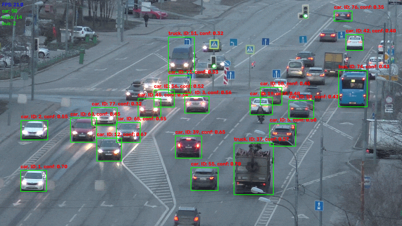

# Object Tracker

Real-time object detection, tracking and counting with Python, OpenCV and YOLO,
using a custom IoU-based tracker written from scratch.



## Features

- **Detection:** Uses a pretrained YOLO26 nano model (Ultralytics), filtered by
  confidence and by class (people and vehicles).
- **Tracking:** A custom IoU-based tracker assigns each object a persistent ID
  across frames and tolerates short occlusions.
- **Robust counting:** Each object is counted only once, after it has been
  confirmed over several frames. Label voting prevents an object from being
  counted twice when the model switches between classes (e.g. car / truck).
- **Live visualization:** Bounding boxes, IDs, confidence scores, FPS and
  per-class counts are drawn on every frame.
- **Webcam or video file:** Works with a live webcam or a video file, and can
  save the annotated output as an MP4 video.

## How it works

Each frame goes through a simple pipeline:

1. **Detection:** YOLO26 returns a bounding box, a class label and a confidence
   score for every object. Low-confidence detections and irrelevant classes
   are filtered out.
2. **Matching:** Each new detection is matched to the existing track whose last
   box has the highest IoU (Intersection over Union) with it. If the IoU is
   above a threshold, the track keeps its ID and its box is updated. Otherwise,
   a new track with a new ID is created.
3. **Lost tracks:** Tracks without a match are kept for a few frames, so short
   occlusions do not break the ID. Tracks that stay lost for too long are removed.
4. **Counting:** A track is counted once, when it has been seen in enough
   frames to be confirmed.
5. **Visualization:** Visible tracks are drawn with their ID, label and
   confidence, together with the FPS and the per-class counts.

### From a naive tracker to robust counting

The first version counted far too many vehicles on a real traffic video.
Two problems caused most of the over-counting:

- **Short-lived detections:** Detections close to the confidence threshold
  appeared and disappeared, and every new track was counted immediately.
  → *Fix:* count a track only after it has been **confirmed** in 3 frames.
- **Class flickering:** The model sometimes switched between `car` and `truck`
  for the same vehicle. Since tracks only matched detections with the same
  label, every switch created a new track.
  → *Fix:* match detections **regardless of the label**, and let each track
  decide its class by **majority vote** over all its detections.

| Version                          | car | truck | bus |
|----------------------------------|----:|------:|----:|
| Naive tracker (conf ≥ 0.5)       | 104 |    12 |   5 |
| + Track confirmation             |  68 |     8 |   3 |
| + Lower confidence (0.3)         |  83 |    30 |   2 |
| + Label voting                   |  53 |    14 |   2 |

*Counts on the same 21-second test video. No ground truth was labeled, so
these numbers show the reduction of duplicate counts, not absolute accuracy.*
## Installation

```bash
git clone https://github.com/alperkucuk-dev/object-tracker.git
cd object-tracker
python -m venv .venv
```

Activate the virtual environment:

```bash
# Windows (PowerShell)
.venv\Scripts\activate

# macOS / Linux
source .venv/bin/activate
```

Install the dependencies:

```bash
pip install -r requirements.txt
```

The YOLO model weights (`yolo26n.pt`) are downloaded automatically on the first run.

## Usage

1. Put a video file into the `videos/` folder, or use your webcam.
2. In `live_detect.py`, set `VIDEO_SOURCE` to the path of your video
   (e.g. `"videos/traffic.mp4"`) or to `0` for the webcam.
3. Run:

   ```bash
   python live_detect.py
   ```

4. Press `q` in the video window to quit. The annotated video is saved to
   `videos/output.mp4`.

Useful settings:

- `ALLOWED_LABELS` in `live_detect.py`: which classes to detect and count
- `min_confidence` in the `detect()` call: detection confidence threshold
- `Tracker(min_iou, max_missed_frames, min_hits)`: matching threshold, how long
  a lost track is kept, and how many frames are needed to confirm a track

## Project structure

| File | Description |
|------|-------------|
| `live_detect.py` | Main script: reads frames, runs detection and tracking, draws and saves the output |
| `detector.py` | Runs YOLO on a frame and converts the results into `BoundingBox` objects |
| `tracker.py` | `Track` and `Tracker` classes: IoU matching, lost tracks, confirmation, label voting and counting |
| `bounding_box.py` | `BoundingBox` class with area, center and IoU calculations |

## Limitations and future work

- Small or distant vehicles are often missed by the nano model. A larger model
  (e.g. YOLO26s) or a GPU would improve detection at the cost of speed.
- Vans and minibuses are sometimes classified as `truck`.
- If an object is lost for longer than `max_missed_frames`, it gets a new ID
  and is counted again (no re-identification).
- The tracker uses only box overlap. Adding motion prediction (e.g. a Kalman
  filter, as in SORT) would help with fast objects and low frame rates.
- **Planned:** line-crossing counting, i.e. counting a vehicle only when it
  crosses a virtual line.

## Credits and license

- Test video by [Nomad 12](https://www.pexels.com/tr-tr/@nomad-12-2772442/) on
  [Pexels](https://www.pexels.com/tr-tr/video/arabalar-trafik-sokak-seyahat-etmek-7395120/)

- Object detection: [Ultralytics YOLO](https://github.com/ultralytics/ultralytics)

- This project is licensed under the AGPL-3.0 license (see `LICENSE`), because
  it uses Ultralytics YOLO, which is AGPL-3.0 licensed.